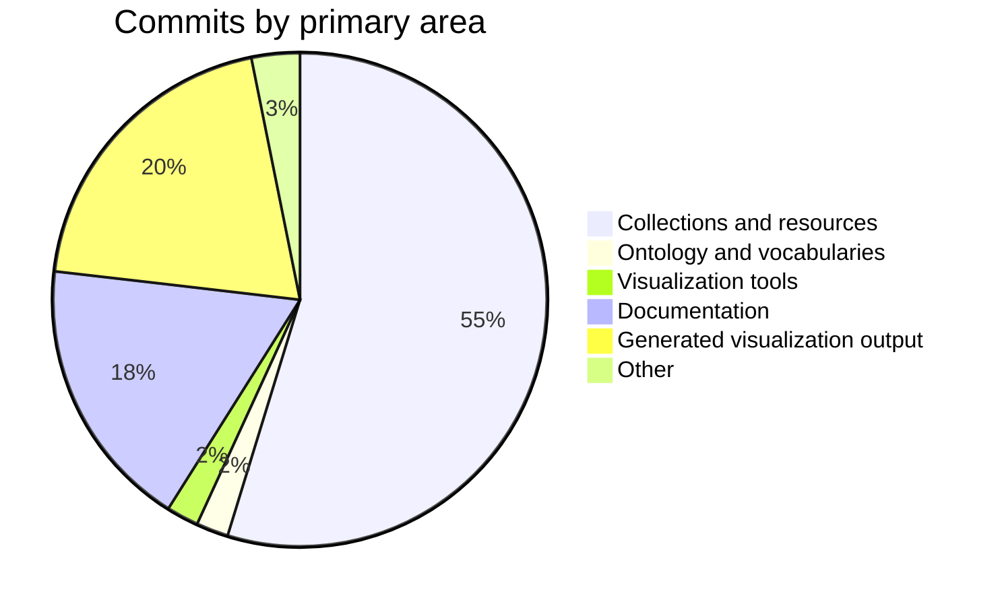

# Changelog — 2026-09-11 to 2026-10-10

Themed summary of git history on `master`. Micro-commits (repeated documentation and regenerated markmaps) are grouped; the narrative follows collections, ontology, tools, and docs.

| | |
|---|---|
| Period | 2026-09-11 → 2026-10-10 |
| Git since / until | `1 month ago` |
| Commits | 95 (66 material, 29 grouped as follow-ups) |
| Authors | Mehran Dhn (95) |
| Files touched | 257 |
| Line churn | +1,216,279 / −348,199 |
| Range | `93281e8` → `6250bcf` |
| Compare | [93281e8…6250bcf](https://github.com/MehranDHN/IIIFCollection/compare/2ffea2ac4cf9c039b791a4ab8e8c930e8f7b8ce9...6250bcff719642e308c718e31e6ef65628c8a2d5) |

## Highlights

- New collection files: `KhavarannamaMetCollection.json`, `LeTourDuMondeCollection.json`, `RuznamahDawlatCollection.json`, `VincentSheeanCollection.json`.
- Catalog-wide JSON updates across 204 collection files (3 commits: “Huge refactoring related to new date structure in E52TimeSpan field”, “After applying fihrist records”).
- Ontology / vocabulary updates touching existing Turtle sources.
- Documentation: 15 slide images added, plus other `docs/` updates.
- New visualization / tool scripts: `generate_narrative_episode_tree.py`, `generate_persons_markmap.py`.
- Refactoring Narrative source.
- Refactor new Date field.

## Activity by area

| Area | Commits |
|---|---:|
| Collections and resources | 52 |
| Ontology and vocabularies | 2 |
| Visualization tools | 2 |
| Documentation | 17 |
| Generated visualization output | 19 |
| Other | 3 |

## Collections and resources

New or dedicated collection work is listed first. Catalog-wide field updates (for example Fihrist enrichment) are summarised rather than repeating every JSON file.

| Collection | Status | Commits | Churn | Notes |
|---|---|---:|---|---|
| `LeTourDuMondeCollection.json` Le Tour Du Monde | New | 3 | +243 / −2 | Refactoring; New subcollection and its resource to Newspaper collection |
| `KhavarannamaMetCollection.json` Khavarannama Met | New | 2 | +977 / −2 | New MET Khavarannama and its resources |
| `RuznamahDawlatCollection.json` Ruznamah Dawlat | New | 2 | +580 / −0 | New subcollection of News and some refactoring |
| `VincentSheeanCollection.json` Vincent Sheean | New | 2 | +209 / −1 | Add new subcollection |
| `PersianManuscriptCollection.json` Persian Manuscript | Dedicated | 15 | +4,193 / −254 | Fix publisher names; Add new resources to Persian Manuscript |
| `SinglePhotoCollection.json` Single Photo | Dedicated | 7 | +1,396 / −63 | Add new resources to Single Photo; Two new resources in Single Photo Collection and one resource to Photo Album |
| `KhamseCollection.json` Khamse | Dedicated | 8 | +1,369 / −175 | Refactoring and adding new resources to Persian manuscript; Refactoring Fihrist record and some new recordes to single photo and single sheet |
| `TurkishManuscriptCollection.json` Turkish Manuscript | Dedicated | 8 | +1,061 / −172 | Refactoring; Fix and refactor |
| `SaadiCollection.json` Saadi | Dedicated | 8 | +521 / −10 | Refactoring and adding new resources to Persian manuscript; New resources to Saadi Collection |
| `ShahnamaCollection.json` Shahnama | Dedicated | 7 | +1,859 / −20 | New resources to Shahnama collection; Refactoring Narrative structure of the Shahnama shah tahmasb and new resource to Shahnama collection |
| `ZakariyaAlQazwiniCollection.json` Zakariya Al Qazwini | Dedicated | 7 | +1,074 / −416 | Fix publisher names; Add new resources to Zakarya Collection |
| `QuranCollection.json` Quran | Dedicated | 7 | +838 / −36 | Fix publisher names; Add new resource to Quran Collection |
| `KufficQuranCollection.json` Kuffic Quran | Dedicated | 6 | +2,899 / −19 | Add new resource to Juffic Quran; New resources to Kuffic Collection |
| `DepartedFolioCollection.json` Departed Folio | Dedicated | 5 | +2,625 / −20 | Refactoring Narrative source; New MET Khavarannama and its resources |
| `MuraqqaCollection.json` Muraqqa | Dedicated | 5 | +1,256 / −35 | Refactoring Narrative source; Adding new resources to Muraqqa |
| `MiscPhotoAlbumCollection.json` Misc Photo Album | Dedicated | 5 | +426 / −16 | Testing new temporal data structure; Two new resources in Single Photo Collection and one resource to Photo Album |
| `ArabicManuscriptCollection.json` Arabic Manuscript | Dedicated | 5 | +372 / −4 | Fixing Date; Refactoring Fihrist record |
| `AbdarRahmanJamiCollection.json` Abdar Rahman Jami | Dedicated | 5 | +368 / −9 | Refactoring Fihrist record and some new recordes to single photo and single sheet; Refactoring Fihrist record |

_Plus 186 further collection JSON file(s) touched only by catalog-wide or small edits._

### Collection commits

- 2 commits `7609494`…`6250bcf` (2026-10-10 – 2026-10-10): Huge refactoring related to new date structure in E52TimeSpan field
- `4b5cef4` (2026-10-10) Fixing Date
- `c83e510` (2026-10-10) Fix publisher names
- `2d394d6` (2026-10-10) Refactor new Date field
- `eec8f72` (2026-10-10) Add new resource to Juffic Quran
- `890508b` (2026-10-10) Add new resource to Quran Collection
- `b929a5e` (2026-10-10) Add new resources to Persian Manuscript
- `effa3ea` (2026-10-09) Add new resources to Single Photo
- `6ae06d2` (2026-10-09) Add new resources to Zakarya Collection
- `e996293` (2026-10-07) Testing new temporal data structure
- `4a740f7` (2026-10-06) Two new resources in Single Photo Collection and one resource to Photo Album
- `6f486b2` (2026-10-06) Two new resources in Single Photo Collection
- `2056d44` (2026-10-03) Add new subcollection
- `b3cf5c4` (2026-10-02) Refactoring
- `1b2d3dd` (2026-10-02) New subcollection of News and some refactoring
- `49da0a5` (2026-10-02) Refactoring
- `b491282` (2026-09-30) New resource to map collection
- `033f07d` (2026-09-30) New subcollection and its resource to Newspaper collection
- …plus 33 further commit(s) in this area.

### New collection files

- `IIIFCollection/KhavarannamaMetCollection.json`
- `IIIFCollection/LeTourDuMondeCollection.json`
- `IIIFCollection/RuznamahDawlatCollection.json`
- `IIIFCollection/VincentSheeanCollection.json`

## Ontology and vocabularies

| File | Commits | Churn |
|---|---:|---|
| `lcsh_rdf_subset.ttl` | 2 | +9,842 / −1,646 |
| `resources.ttl` | 2 | +6,165 / −1,044 |
| `PersonsRDFData.ttl` | 2 | +1,663 / −828 |
| `narrative_episodes.ttl` | 1 | +686 / −190 |
| `iconclass_hierarchy.ttl` | 2 | +537 / −0 |
| `aat_hierarchy.ttl` | 2 | +306 / −13 |
| `iiifCollectionOntology.ttl` | 1 | +196 / −3 |
| `iconography_RDF.ttl` | 2 | +133 / −20 |
| `ctl_vocabs.ttl` | 1 | +13 / −2 |
| `tgn_subset_updated.ttl` | 1 | +8 / −1 |
| `LCTGM_RDF.migrated.ttl` | 2 | +5 / −0 |

- `86f3625` (2026-10-02) Updating controll vocabularies and turtle data
- `e10b21a` (2026-09-29) Updateing Ontology based on Fihrist Integration and huge updates of the Turtle data

## Visualization and tools

New scripts and query files:

- `IIIFCollection/tools/visualization/generate_narrative_episode_tree.py`
- `IIIFCollection/tools/visualization/generate_persons_markmap.py`

- `cc03f99` (2026-09-29) Adding markmap visualization script for Episode-based report
- `b9aef15` (2026-09-29) Adding markmap visualization script for Agential

Generated markmaps / DOT / report artefacts were regenerated in 19 follow-up commit(s); they are omitted from the narrative.

## Documentation

- `IIIFCollection/images/docs/slides/` — 15 slide image(s)
- `IIIFCollection/docs/changelog_2026-08-20_2026-09-19.md`
- `IIIFCollection/docs/changelog_2026-08-27_2026-09-27.md`
- `IIIFCollection/docs/changelog_2026-08-29_2026-09-29.md`
- `IIIFCollection/images/docs/Digital_Knowledge_Tree.jpg`
- `IIIFCollection/images/docs/IIIF_Digital_Heritage_Ecosystem_Guide.jpg`

- `cfaee1c` (2026-09-29) Updating Changelog report
- `2e55d3c` (2026-09-27) New change log report 09-27-2026
- `469cb98` (2026-09-23) Update with new description about slides
- `1242994` (2026-09-19) First Changelog report in markdown format
- 2 commits `4f96257`…`72546b7` (2026-09-16 – 2026-09-16): Update with draft of slides
- `5e447c3` (2026-09-16) Adding IIIF Slides

- 10 small documentation follow-ups `10918f5`…`2e70ff2` (2026-09-14 – 2026-09-23), mostly `docs/IIIF.md` and related images.

## Activity snapshot

| Week | Commits |
|---|---:|
| 2026-W37 | 7 |
| 2026-W38 | 29 |
| 2026-W39 | 23 |
| 2026-W40 | 23 |
| 2026-W41 | 13 |

Busiest days:

- **2026-09-29** — 10 commits
- **2026-09-17** — 9 commits
- **2026-09-16** — 9 commits
- **2026-10-10** — 8 commits
- **2026-09-27** — 8 commits
- **2026-09-23** — 6 commits
- **2026-09-18** — 5 commits
- **2026-09-13** — 5 commits

Most frequently committed files:

| File | Commits |
|---|---:|
| `IIIFCollection/PersianManuscriptCollection.json` | 15 |
| `IIIFCollection/tools/visualization/canvas_decomposition.markmap.md` | 13 |
| `IIIFCollection/docs/IIIF.md` | 13 |
| `IIIFCollection/KhamseCollection.json` | 8 |
| `IIIFCollection/SaadiCollection.json` | 8 |
| `IIIFCollection/TurkishManuscriptCollection.json` | 8 |
| `IIIFCollection/QuranCollection.json` | 7 |
| `IIIFCollection/ShahnamaCollection.json` | 7 |
| `IIIFCollection/ZakariyaAlQazwiniCollection.json` | 7 |
| `IIIFCollection/SinglePhotoCollection.json` | 7 |
| `IIIFCollection/KufficQuranCollection.json` | 6 |
| `IIIFCollection/AbdarRahmanJamiCollection.json` | 5 |

## Commit appendix

Material commits (documentation/markmap follow-ups collapsed):

| Date | SHA | Subject |
|---|---|---|
| 2026-10-10 | `6250bcf` | Huge refactoring related to new date structure in E52TimeSpan field † |
| 2026-10-10 | `7609494` | Huge refactoring related to new date structure in E52TimeSpan field † |
| 2026-10-10 | `4b5cef4` | Fixing Date |
| 2026-10-10 | `c83e510` | Fix publisher names |
| 2026-10-10 | `2d394d6` | Refactor new Date field |
| 2026-10-10 | `eec8f72` | Add new resource to Juffic Quran |
| 2026-10-10 | `890508b` | Add new resource to Quran Collection |
| 2026-10-10 | `b929a5e` | Add new resources to Persian Manuscript |
| 2026-10-09 | `effa3ea` | Add new resources to Single Photo |
| 2026-10-09 | `6ae06d2` | Add new resources to Zakarya Collection |
| 2026-10-07 | `e996293` | Testing new temporal data structure |
| 2026-10-06 | `4a740f7` | Two new resources in Single Photo Collection and one resource to Photo Album |
| 2026-10-06 | `6f486b2` | Two new resources in Single Photo Collection |
| 2026-10-03 | `2056d44` | Add new subcollection |
| 2026-10-02 | `86f3625` | Updating controll vocabularies and turtle data |
| 2026-10-02 | `b3cf5c4` | Refactoring |
| 2026-10-02 | `1b2d3dd` | New subcollection of News and some refactoring |
| 2026-10-02 | `49da0a5` | Refactoring |
| 2026-09-30 | `990a8a4` | Refactoring Fihrist and sharing single common data |
| 2026-09-30 | `b491282` | New resource to map collection |
| 2026-09-30 | `033f07d` | New subcollection and its resource to Newspaper collection |
| 2026-09-29 | `2f4f460` | Fix and refactor |
| 2026-09-29 | `cfaee1c` | Updating Changelog report |
| 2026-09-29 | `cc03f99` | Adding markmap visualization script for Episode-based report |
| 2026-09-29 | `b9aef15` | Adding markmap visualization script for Agential |
| 2026-09-29 | `e10b21a` | Updateing Ontology based on Fihrist Integration and huge updates of the Turtle data |
| 2026-09-29 | `4febbe6` | Refactoring and adding new resources to Persian manuscript |
| 2026-09-29 | `00f095e` | New resource to Turkish Collection |
| 2026-09-29 | `b014f53` | Adding new resource to Turkisj collection |
| 2026-09-28 | `a12c76a` | Adding stata harvesting from Fihrist project |
| 2026-09-28 | `94b3d75` | Adding new resources to persian manuscript |
| 2026-09-27 | `31c749e` | Adding new resource to Persian Manuscript |
| 2026-09-27 | `2460a5f` | Moving two resources to Persian manuscript collection |
| 2026-09-27 | `2268a58` | New resources to Shahnama collection |
| 2026-09-27 | `c187d7c` | New resources to Saadi Collection |
| 2026-09-27 | `c1c7af5` | New resources to Saadi Collection |
| 2026-09-27 | `f292192` | New resources to persian manuscript and moving two existing resources |
| 2026-09-27 | `2e55d3c` | New change log report 09-27-2026 |
| 2026-09-27 | `8d6ad1f` | Refactoring Narrative structure of the Shahnama shah tahmasb and new resource to Shahnama collection |
| 2026-09-25 | `ec6b8c7` | Refactoring Narrative source |
| 2026-09-25 | `fd59b78` | Refactoring Narrative source |
| 2026-09-25 | `760058b` | Refactoring |
| 2026-09-25 | `01df184` | New resource to Mir Emad Collection |
| 2026-09-24 | `096ce13` | Fix Agential mistake |
| 2026-09-24 | `c5ab71f` | New photograph to Bement Smith Collection |
| 2026-09-23 | `469cb98` | Update with new description about slides |
| 2026-09-21 | `ac060d7` | Refactoring Fihrist record and some new recordes to single photo and single sheet |
| 2026-09-21 | `6be9d22` | Refactoring Fihrist record |
| 2026-09-19 | `1242994` | First Changelog report in markdown format |
| 2026-09-19 | `7d8795a` | New Canvases |
| 2026-09-19 | `7404513` | New MET Khavarannama and its resources |
| 2026-09-18 | `f28094b` | Enrich with Fihrist records |
| 2026-09-18 | `100b9e0` | Add new canvases to Khamse collection |
| 2026-09-17 | `f38ec14` | Enrich with Fihrist Records |
| 2026-09-17 | `f8f1748` | After applying fihrist records † |
| 2026-09-17 | `375787c` | After applying fihrist records |
| 2026-09-16 | `1f4f492` | New resources to Khamse collection |
| 2026-09-16 | `9ed77b7` | New resources to Kuffic Collection |
| 2026-09-16 | `72546b7` | Update with draft of slides |
| 2026-09-16 | `4f96257` | Update with draft of slides |
| 2026-09-16 | `5e447c3` | Adding IIIF Slides |
| 2026-09-16 | `ff76ed1` | Adding new canvases to Shahnama collection |
| 2026-09-16 | `49246ea` | Adding new resources to Quran Collection |
| 2026-09-16 | `2f90faf` | Adding new resources to Muraqqa |
| 2026-09-16 | `cf38e7b` | Adding new canvases to Juffic collection and introducing reference to Fihrist |
| 2026-09-13 | `6ba342a` | Adding new canvases to Zakaria Qazvini collection |

† Catalog-wide collection JSON update.

All 95 commits

| Date | SHA | Subject |
|---|---|---|
| 2026-10-10 | `6250bcf` | Huge refactoring related to new date structure in E52TimeSpan field |
| 2026-10-10 | `7609494` | Huge refactoring related to new date structure in E52TimeSpan field |
| 2026-10-10 | `4b5cef4` | Fixing Date |
| 2026-10-10 | `c83e510` | Fix publisher names |
| 2026-10-10 | `2d394d6` | Refactor new Date field |
| 2026-10-10 | `eec8f72` | Add new resource to Juffic Quran |
| 2026-10-10 | `890508b` | Add new resource to Quran Collection |
| 2026-10-10 | `b929a5e` | Add new resources to Persian Manuscript |
| 2026-10-09 | `effa3ea` | Add new resources to Single Photo |
| 2026-10-09 | `6ae06d2` | Add new resources to Zakarya Collection |
| 2026-10-07 | `e996293` | Testing new temporal data structure |
| 2026-10-06 | `4a740f7` | Two new resources in Single Photo Collection and one resource to Photo Album |
| 2026-10-06 | `6f486b2` | Two new resources in Single Photo Collection |
| 2026-10-03 | `786b98f` | Update decomposition markmap |
| 2026-10-03 | `06cbf0e` | Update decomposition markmap |
| 2026-10-03 | `eaaee79` | Update decomposition markmap |
| 2026-10-03 | `2056d44` | Add new subcollection |
| 2026-10-02 | `86f3625` | Updating controll vocabularies and turtle data |
| 2026-10-02 | `b3cf5c4` | Refactoring |
| 2026-10-02 | `1b2d3dd` | New subcollection of News and some refactoring |
| 2026-10-02 | `49da0a5` | Refactoring |
| 2026-09-30 | `990a8a4` | Refactoring Fihrist and sharing single common data |
| 2026-09-30 | `b491282` | New resource to map collection |
| 2026-09-30 | `033f07d` | New subcollection and its resource to Newspaper collection |
| 2026-09-29 | `2f4f460` | Fix and refactor |
| 2026-09-29 | `90ce650` | Updating persons visualization report |
| 2026-09-29 | `cfaee1c` | Updating Changelog report |
| 2026-09-29 | `cb3202d` | Updating visualization reports |
| 2026-09-29 | `cc03f99` | Adding markmap visualization script for Episode-based report |
| 2026-09-29 | `b9aef15` | Adding markmap visualization script for Agential |
| 2026-09-29 | `e10b21a` | Updateing Ontology based on Fihrist Integration and huge updates of the Turtle data |
| 2026-09-29 | `4febbe6` | Refactoring and adding new resources to Persian manuscript |
| 2026-09-29 | `00f095e` | New resource to Turkish Collection |
| 2026-09-29 | `b014f53` | Adding new resource to Turkisj collection |
| 2026-09-28 | `a12c76a` | Adding stata harvesting from Fihrist project |
| 2026-09-28 | `94b3d75` | Adding new resources to persian manuscript |
| 2026-09-27 | `31c749e` | Adding new resource to Persian Manuscript |
| 2026-09-27 | `2460a5f` | Moving two resources to Persian manuscript collection |
| 2026-09-27 | `2268a58` | New resources to Shahnama collection |
| 2026-09-27 | `c187d7c` | New resources to Saadi Collection |
| 2026-09-27 | `c1c7af5` | New resources to Saadi Collection |
| 2026-09-27 | `f292192` | New resources to persian manuscript and moving two existing resources |
| 2026-09-27 | `2e55d3c` | New change log report 09-27-2026 |
| 2026-09-27 | `8d6ad1f` | Refactoring Narrative structure of the Shahnama shah tahmasb and new resource to Shahnama collection |
| 2026-09-26 | `825ecee` | Add narrative visualization sample report |
| 2026-09-25 | `ec6b8c7` | Refactoring Narrative source |
| 2026-09-25 | `fd59b78` | Refactoring Narrative source |
| 2026-09-25 | `760058b` | Refactoring |
| 2026-09-25 | `01df184` | New resource to Mir Emad Collection |
| 2026-09-24 | `096ce13` | Fix Agential mistake |
| 2026-09-24 | `c5ab71f` | New photograph to Bement Smith Collection |
| 2026-09-23 | `2e70ff2` | Update with new description about slides |
| 2026-09-23 | `8945e44` | Update with new description about slides |
| 2026-09-23 | `15fa83e` | Update with new description about slides |
| 2026-09-23 | `8e8d03e` | Update with new description about slides |
| 2026-09-23 | `158c218` | Update with new description about slides |
| 2026-09-23 | `469cb98` | Update with new description about slides |
| 2026-09-21 | `ac060d7` | Refactoring Fihrist record and some new recordes to single photo and single sheet |
| 2026-09-21 | `6be9d22` | Refactoring Fihrist record |
| 2026-09-19 | `1242994` | First Changelog report in markdown format |
| 2026-09-19 | `7d8795a` | New Canvases |
| 2026-09-19 | `7404513` | New MET Khavarannama and its resources |
| 2026-09-18 | `08a19c3` | Update visualization markup |
| 2026-09-18 | `fbd6e79` | Update visualization markup |
| 2026-09-18 | `f28094b` | Enrich with Fihrist records |
| 2026-09-18 | `100b9e0` | Add new canvases to Khamse collection |
| 2026-09-18 | `6259780` | Update visualization markup |
| 2026-09-17 | `f38ec14` | Enrich with Fihrist Records |
| 2026-09-17 | `e08dfcf` | Update canvas decomposition markmap |
| 2026-09-17 | `47d644d` | Update canvas decomposition markmap |
| 2026-09-17 | `b14c329` | Update canvas decomposition markmap |
| 2026-09-17 | `9b55a83` | Update IIIF.md with description of Slide01 |
| 2026-09-17 | `8221885` | Update IIIF.md with description of Slide01 |
| 2026-09-17 | `70dff35` | Update canvas decomposition markmap |
| 2026-09-17 | `f8f1748` | After applying fihrist records |
| 2026-09-17 | `375787c` | After applying fihrist records |
| 2026-09-16 | `1f4f492` | New resources to Khamse collection |
| 2026-09-16 | `9ed77b7` | New resources to Kuffic Collection |
| 2026-09-16 | `72546b7` | Update with draft of slides |
| 2026-09-16 | `4f96257` | Update with draft of slides |
| 2026-09-16 | `5e447c3` | Adding IIIF Slides |
| 2026-09-16 | `ff76ed1` | Adding new canvases to Shahnama collection |
| 2026-09-16 | `49246ea` | Adding new resources to Quran Collection |
| 2026-09-16 | `2f90faf` | Adding new resources to Muraqqa |
| 2026-09-16 | `cf38e7b` | Adding new canvases to Juffic collection and introducing reference to Fihrist |
| 2026-09-14 | `ba16aac` | Update IIIF.md |
| 2026-09-14 | `6796c40` | Update IIIF.md with two new slide |
| 2026-09-14 | `10918f5` | Update IIIF.md |
| 2026-09-13 | `b46b434` | Update markmap decomposition |
| 2026-09-13 | `3e5bfab` | Update markmap decomposition |
| 2026-09-13 | `280b9e7` | Update markmap decomposition |
| 2026-09-13 | `50cb414` | Update markmap decomposition |
| 2026-09-13 | `6ba342a` | Adding new canvases to Zakaria Qazvini collection |
| 2026-09-11 | `b3377e3` | Update visualization markmap |
| 2026-09-11 | `93281e8` | Update visualization markmap |

---

_Generated 2026-10-11 11:43 +0330 by `IIIFCollection/tools/generate_changelog.py`. Command: `python IIIFCollection/tools/generate_changelog.py --since "1 month ago"`._
